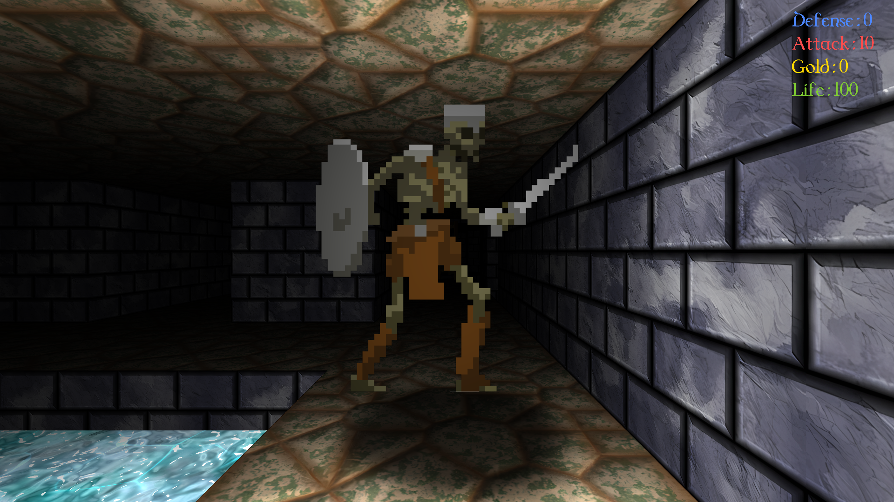
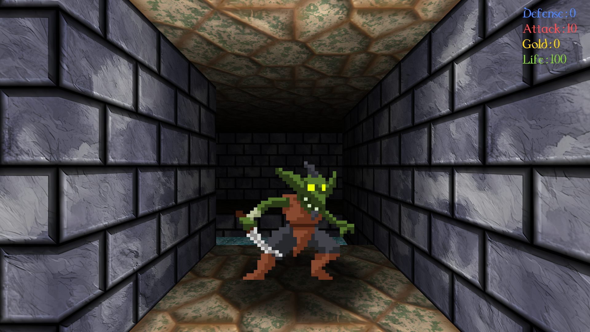
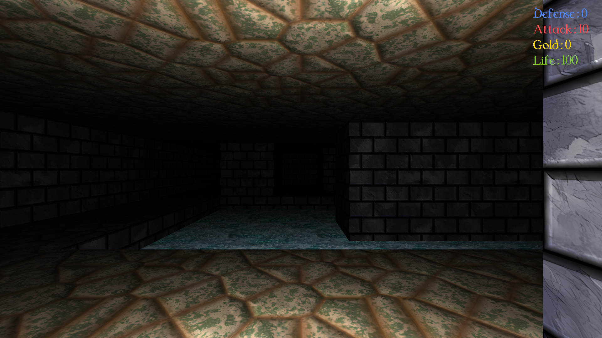
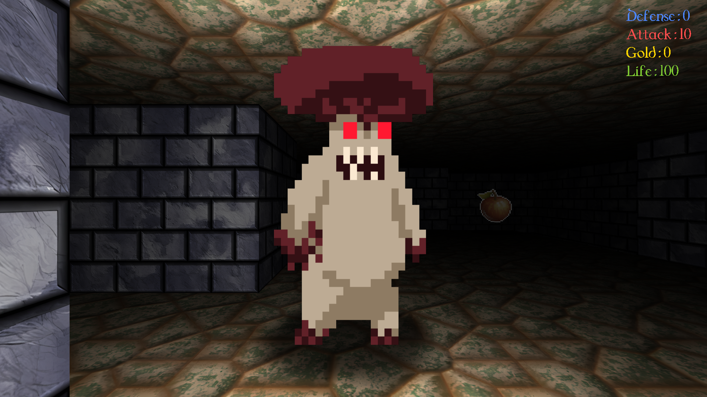

# Dungeon Master — C++ / OpenGL dungeon crawler

A first-person dungeon crawler built as a master's-level graphics project. Explore three floors, fight monsters, collect items, and unlock doors in a custom C++/OpenGL engine.

## Video

**[Watch or download the 20-second video tour (1080p, 30 fps)](docs/media/dungeon-crawler-tour.mp4)**

[](docs/media/dungeon-crawler-tour.mp4)

The video shows four scenes with smooth camera movement: a goblin encounter, water and lighting, a skeleton corridor, and the mushroom boss. It is a silent, scripted camera tour rendered by the game, with gameplay simulation paused.

## Screenshots

| Goblin encounter | Water and lighting |
| --- | --- |
|  |  |
| Skeleton corridor | Mushroom boss |
|  |  |

## Features

- Custom rendering loop, shader management, and texture/model managers.
- Point-light shading in GLSL and camera-facing sprites for monsters and items.
- An object-oriented gameplay layer for the player, monsters, items, doors, and ladders.
- Combat, health and equipment bonuses, gold collection, and paid doors with opening animations.
- Three floors connected by ladders and holes, with maps and entity data loaded from PPM and JSON files.
- A text HUD showing health, gold, attack, and defense, plus interaction messages.

## Build and run

Requirements: CMake 3.20 or newer, a C++11-capable compiler, and an OpenGL 3.3-capable driver. GLFW's platform development dependencies are also required on Linux. CMake downloads JSON for Modern C++ and FreeType during configuration, so the first build needs internet access.

```sh
git clone https://github.com/lebonq/Projet-DM-M2.git
cd Projet-DM-M2
cmake -S . -B build -DCMAKE_BUILD_TYPE=Release
cmake --build build --parallel
./bin/Release/Projet_DM_Quentin_Lebon_exe
```

Run from the repository root so relative paths to `assets/` and `src/shaders/` resolve correctly. The executable path above is for a single-configuration Linux build.

## Controls

| Key (QWERTY) | Action |
| --- | --- |
| W / S | Move forward / backward |
| A / D | Strafe left / right |
| Q / E | Turn left / right |
| Space | Interact, collect an item, attack, or use a ladder/hole |
| R | Restart after death |

On an AZERTY keyboard, the corresponding movement keys are ZQSD, with A/E for turning. The HUD appears in the top-right corner.

## Credits and references

### Artwork and font

- Item sprites: [Pixel Art Icon Pack RPG](https://cainos.itch.io/pixel-art-icon-pack-rpg) by Cainos.
- Monster sprites: [Monsters Creatures Fantasy](https://luizmelo.itch.io/monsters-creatures-fantasy) by LuizMelo.
- Wall, water, floor, and door textures: [Tiny Texture Pack 2](https://screamingbrainstudios.itch.io/tiny-texture-pack-2) by Screaming Brain Studios, upscaled with [Upscayl](https://upscayl.github.io/).
- Font: [Dungeon SN](https://www.dafont.com/dungeon-sn.font).

### Code references

- The GLSL `rotationMatrix()` function in `src/shaders/3D_facing.vs.glsl` comes from [Neil Mendoza's arbitrary-axis rotation example](https://www.neilmendoza.com/glsl-rotation-about-an-arbitrary-axis/).
- Text rendering follows the [LearnOpenGL text-rendering tutorial](https://learnopengl.com/In-Practice/Text-Rendering). The text shaders and parts of `TextRenderer.cpp` adapt that tutorial to the project's class structure.

### Libraries

GLFW, GLAD, Glimac, [GLM](https://github.com/g-truc/glm), [PPMIo](https://github.com/leimao/PPMIo), [JSON for Modern C++](https://github.com/nlohmann/json), and FreeType.

Project code is licensed under the [MIT License](LICENSE). Third-party assets and libraries retain their respective licenses.
